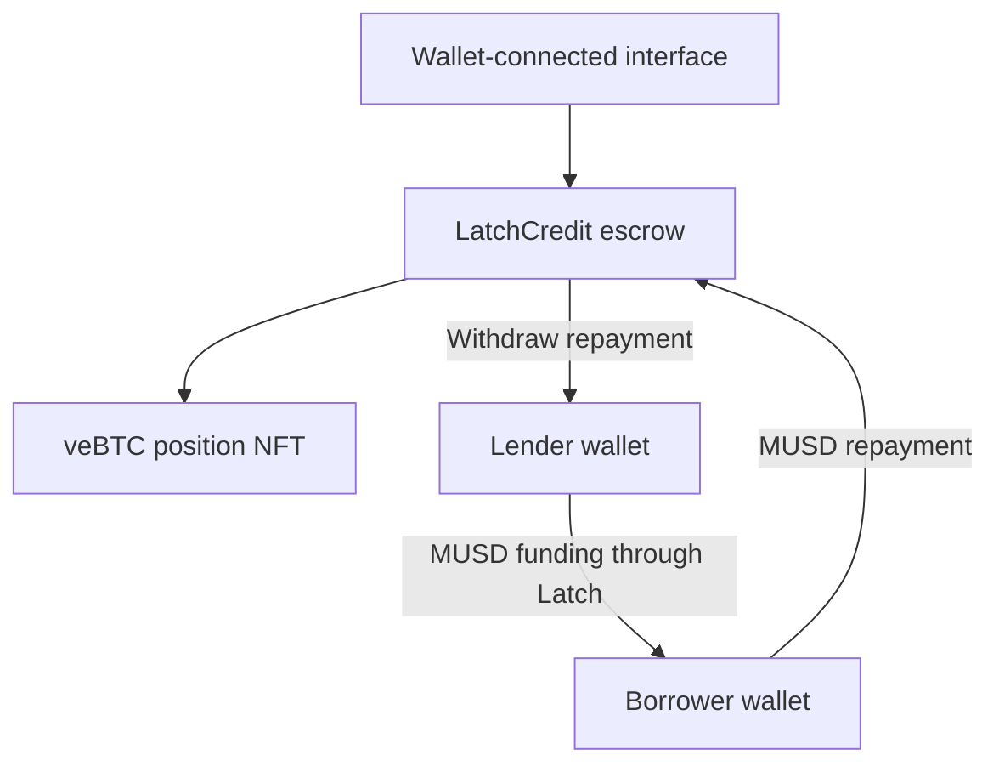

# Latch

**MUSD credit against the Bitcoin you already locked.**

[Open Latch](https://latch-credit.vercel.app/) · [Loan evidence](#verified-on-chain) · [Run locally](#run-locally) · [Contract documentation](docs/CONTRACTS.md)

Latch is a fixed-term credit market for eligible veBTC positions on Mezo. A borrower escrows an existing position NFT, a separate lender supplies MUSD, and repayment returns the NFT claim to the borrower.

**Status:** deployed on Mezo Testnet. A complete builder-controlled loan cycle has been executed. Experimental and unaudited; independent borrower demand and lender economics remain unvalidated.

## The problem

A veBTC holder may need liquidity before their Bitcoin unlocks. The BTC inside that position is not available as ordinary liquid collateral. Latch accepts the eligible position NFT instead, creating a way to request MUSD without first withdrawing the underlying Bitcoin.

The initial user is an existing veBTC holder seeking short-term liquidity. The counterparty is a lender willing to assess that position, agree to its terms and bear the recovery delay. Funding is voluntary, not guaranteed.

## How it works

| Step | What happens |
| --- | --- |
| Request | The borrower chooses principal, fixed interest and term, then escrows an eligible NFT. |
| Review | A lender sees locked BTC, return over the actual loan term, repayment timing and the BTC unlock date. |
| Fund | The lender transfers existing MUSD directly to the borrower. The loan clock starts at funding. |
| Repay | The borrower pays principal plus fixed interest. The borrower receives an NFT claim and the lender receives a repayment balance. |
| Collect | The borrower claims the NFT; the lender withdraws MUSD in separate transactions. |

If an active loan remains unpaid after its one-day grace period, only its lender can claim default and then claim the NFT. **NFT recovery is not immediate BTC recovery:** withdrawal remains subject to the underlying lock and voting restrictions.

An unfunded request can be cancelled. The UI uses a 24-hour funding window. Fixed interest is payable in full even on early repayment.

## Why Mezo

Latch uses both sides of an existing Mezo position: **veBTC as transferable collateral and MUSD as the funding and repayment asset**. Ownership, escrow type, locked amount and expiration are read from the deployed contracts. Eligibility is checked at request and funding.

Latch does not mint MUSD or open a Mezo borrowing position. It adds a lender-funded credit workflow around an eligible position that already exists. It does not forward voting rights or rewards while the NFT is escrowed.

## Verified on-chain

Loan #1 completed on October 23, 2026 using veBTC #1705, representing **0.001 BTC**, with **1 MUSD principal**, **zero interest** and a **seven-day term**, repaid early.

Both wallets were controlled by the builder. This is evidence of an exercised integration, not independent adoption or profitable lending.

| Step | On-chain evidence |
| --- | --- |
| Request and escrow | [Request](https://explorer.test.mezo.org/tx/0xe407fbbdddffbaf43d91c468b8a29cd0d98421e55ba61f51e1170935112d2637) |
| Lender funds borrower | [Funding](https://explorer.test.mezo.org/tx/0xab16a01501b2dd46d544cf39c0f2740285679fda0d78caba5a42ff6ded936428) |
| Borrower repays | [Repayment](https://explorer.test.mezo.org/tx/0x20cf917014d8c2f714cf2b7caca9a941fd08fc78d7a706969e37ad19312f916d) |
| Borrower claims NFT | [Collateral claim](https://explorer.test.mezo.org/tx/0x4b09e55660ff79b5427747a31a1c6ed89573b670ddfbd4fcf9591ea44d7f9b7a) |
| Lender withdraws repayment | [Withdrawal](https://explorer.test.mezo.org/tx/0x323bb79a8b59f56f68c329b152633309470be5ec765689fbec84986a1e8f50fc) |

At verification, the loan was Repaid, the NFT was back with its borrower, the loan/claim mappings were cleared, and the lender's repayment balance was zero after withdrawal. These are recorded observations, not a live balance feed. Default recovery has been tested locally with mocks, not demonstrated on the live deployment.

## Run locally

Requires Node.js 22 or newer. The bundled interface runs without installing dependencies:

```sh
git clone https://github.com/theeagle2407/latch-credit.git
cd latch-credit
npm start
```

Open http://localhost:3000. If that port is occupied, run `PORT=3001 npm start` and open http://localhost:3001.

Connect an installed EVM wallet and approve the switch to Mezo Testnet. Borrowers need an eligible veBTC NFT and BTC for gas; lenders need MUSD and BTC for gas. Repayment requires principal plus the agreed interest. Visitors use the existing deployment and never deploy a contract.

## Verify the implementation

```sh
npm ci
npm test
npm run test:client
npm run build
```

The contract suite contains 13 checks; the client suite contains eight integration groups. They exercise authorization, eligibility, escrow, self-funding rejection, approvals, failed repayment, settlement, claims, withdrawal and default timing using mock tokens on a local EVM. They do not establish full compatibility with every real veBTC state or constitute an audit.

The included GitHub Actions workflow runs these checks and builds the public app on pushes and pull requests. Check the repository's Actions tab for actual run results; no passing status is assumed here.

An optional live-network check verifies configured deployments and token metadata:

```sh
npm run check:network
```

Ganache can fall back to JavaScript when its optional native uWS binary is unavailable. A previous dependency audit reported 39 findings in the development dependency tree; these have not been comprehensively remediated. The public deployment serves bundled assets and skips dependency installation.

## Architecture



| Component | Responsibility |
| --- | --- |
| `contracts/LatchCredit.sol` | Immutable token configuration, loan state, collateral escrow and settlement. |
| `dist/chain.js` | Chain reads, eligibility checks, integer amounts, scoped approvals and transaction preflight. |
| `dist/wallet.js` | EIP-6963 wallet discovery, account changes and network switching. |
| `dist/app.js` | Positions, Credit market, Activity and loan review. |
| `scripts/build-public.cjs` | Builds the public static bundle without developer deployment pages. |

The contract has no administrator or upgrade mechanism. SafeERC20 and ReentrancyGuard protect token operations and lifecycle mutations. Separate settlement and delivery let recipients claim assets without making repayment depend on NFT receiver behavior.

## Deployment

| Contract | Mezo Testnet address |
| --- | --- |
| LatchCredit | `0xf65dd90ffe34da7f5e12938a174b8bcaf46b67bd` |
| MUSD | `0x118917a40FAF1CD7a13dB0Ef56C86De7973Ac503` |
| veBTC | `0x38E35d92E6Bfc6787272A62345856B13eA12130a` |

Chain ID **31611** · native gas **BTC** · RPC `https://rpc.test.mezo.org`.

[Deployment transaction](https://explorer.test.mezo.org/tx/0xe8986547642643c56b553cb0af37681ca01f80a811fe3f46daaa86a5fd0e4a04)

To publish the interface against this deployment:

```sh
npm run build
npx vercel --prod
```

See [hosting](docs/PUBLISH.md) and [developer deployment](docs/DEPLOY.md).

## Current boundaries

- **Underwriting:** no oracle, automatic LTV cap or price-triggered liquidation. Lenders select requests and can lose money if collateral recovery is insufficient.
- **Liquidity:** no guaranteed funding, pooled liquidity or validated lending business model. The contract currently charges no protocol fee.
- **Position rights:** no voting or reward forwarding in escrow. Recovery remains subject to Mezo's position rules.
- **Loan features:** no partial repayment; early repayment still owes all fixed interest.
- **Security:** no independent audit. Real veBTC fork coverage, adversarial testing and production deployment review remain outstanding. Direct NFT transfers outside the request flow can strand collateral.
- **Wallet support:** installed EVM wallets; no mobile QR connection.

The next milestones are independent borrower/lender validation, stronger recovery-path evidence and security review. None are represented as completed.

## License

Original project code is MIT licensed; see [LICENSE](LICENSE). Bundled third-party code retains its own notices, including [ethers](dist/vendor/ethers-LICENSE.md).
